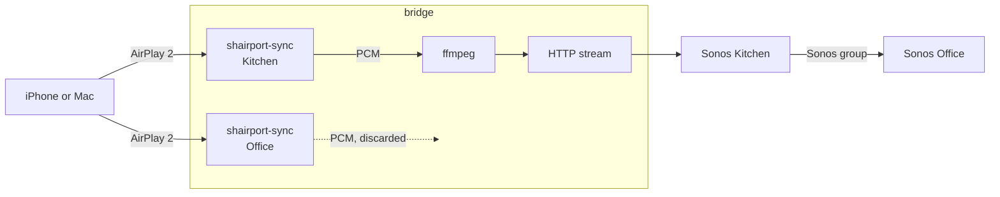

# airplay2-sonos-bridge

Play to older Sonos speakers from the AirPlay menu of an iPhone or a Mac, with
AirPlay 2 multi-room selection: tick several rooms, and they play together.

Sonos S1 speakers such as the Play:1 and Play:3 have no AirPlay at all. This bridge
runs on a small always-on machine on the same network and makes each room appear as
an AirPlay 2 speaker.

> **Status:** early. Tested with an iPhone, on a Mac running the bridge, with a Play:1
> and a Play:3 on S1 firmware 11.16.1. See [What has been tested](#what-has-been-tested).

## How it works



[shairport-sync](https://github.com/mikebrady/shairport-sync) does the real AirPlay 2
work: pairing, encryption, timing and decoding. One instance runs per room.

The bridge does not keep those instances in sync, and does not need to. Rooms selected
together by a sender form a session: the first one receives the stream, the others are
put in its Sonos group, and their audio is read and thrown away. Sonos handles the
synchronisation between rooms as it always does.

Each sender gets its own session, so two people can play to different rooms.

## What it does

| Situation | Behaviour |
|---|---|
| A room is ticked | The stream starts as soon as title and cover arrive (2 s at most) |
| Another room is ticked | It joins the Sonos group of the first |
| The first room is unticked | The stream restarts on a remaining room, with a short cut |
| The track changes | Title, artist and cover update, with a cut of about 4 s (see [Limitations](#limitations)) |
| The sender gives no track information | Sonos shows `AirPlay - <device name>` |
| A volume slider moves | That room's Sonos volume follows |

### When something else happens

| Event | Behaviour | Detected within |
|---|---|---|
| Sonos already plays another source, or belongs to a group, when AirPlay starts | AirPlay takes over | Immediately |
| Spotify Connect, the Sonos app or line-in takes over during AirPlay | The other source keeps playing and the sender is disconnected | 5 s |
| Playback is stopped from the Sonos app | The sender is disconnected | 5 s |
| A room is taken out of the group | Only that room's sender connection is closed | 5 s |
| Sonos reports a playback error | The stream is reloaded three times, then the sender is disconnected | Seconds |
| Sonos is unreachable | Retried, its address looked up again, and the session ended after 15 s | 3 s |
| A Sonos changes IP address | Followed through discovery | At the next failed call, or 60 s |
| A speaker is added to the network | Offered in the AirPlay menu | 60 s |
| A sender stays connected without sending audio | Its instance is restarted | 20 s |
| `shairport-sync` crashes | Restarted, waiting up to 30 s if it keeps crashing | 250 ms |
| `nqptp` crashes | Restarted, along with every instance | 250 ms |
| The encoder crashes | Restarted and the stream reloaded, up to five times per session | 250 ms |
| The bridge crashes or hangs | Restarted by systemd, which also cleans up what is left | 60 s at most |
| Nothing has played for 30 minutes after a session | Instances restart to start clean | |

A sender cannot be told to reconnect: after a crash or a disconnection, select the
speaker again in the AirPlay menu.

## Requirements

- macOS, or Debian and its derivatives
- Python 3.9 or later, with no extra packages
- Sonos speakers and the machine on the same network, with multicast allowed
- UDP ports 319 and 320 free, as `nqptp` needs them for itself. This rules out running
  next to another AirPlay 2 receiver using PTP on the same machine

Expect around 5% of a low-end CPU (Atom x5-Z8350) and under 100 MB of memory. These are
estimates from measuring each stage on that CPU and the whole bridge on a Mac.

## Install

`install.sh` builds the pinned versions of `shairport-sync` and `nqptp` into `.deps/`,
and uses Homebrew or `apt` for the libraries. On Linux, this asks for `sudo`.

```sh
git clone https://github.com/Frulko/airplay2-sonos-bridge.git
cd airplay2-sonos-bridge
./install.sh
```

## Run

```sh
./bridge.py
```

Speakers are discovered automatically and appear as `<room> AP2`. If discovery is
blocked on your network, give their addresses: `./bridge.py 192.168.1.20 192.168.1.21`.

On macOS, the AirPlay Receiver setting can stay on, as the bridge uses other ports.

### As a Linux service

```sh
sudo useradd --system --no-create-home airplay
sudo git clone https://github.com/Frulko/airplay2-sonos-bridge.git /opt/airplay2-sonos-bridge
sudo chown -R airplay /opt/airplay2-sonos-bridge
cd /opt/airplay2-sonos-bridge && sudo -u airplay ./install.sh
sudo cp systemd/airplay2-sonos-bridge.service /etc/systemd/system/
sudo systemctl enable --now airplay2-sonos-bridge
journalctl -fu airplay2-sonos-bridge
```

The `airplay` user has no `sudo`, so install the `apt` packages from `install.sh`
yourself first if the build asks for them.

### Options

| Option | Default | Purpose |
|---|---|---|
| `--codec {mp3,flac}` | `mp3` | Format sent to Sonos, see [Audio quality](#audio-quality) |
| `--name` | `{room} AP2` | Name in the AirPlay menu |
| `--max-volume` | `100` | Sonos volume with the slider at full |
| `--start-volume` | `50` | Highest volume applied when a session starts |
| `--idle-restart` | `30` | Minutes before the clean restart, `0` to disable |
| `--http-port` | `7099` | Port of the audio stream |
| `--first-port` | `7021` | AirPlay port of the first speaker |

## Audio quality

The sender chooses what it sends. In testing it was always AAC at 48 kHz.
`shairport-sync` also advertises ALAC, so a lossless source may arrive lossless.

| | `mp3` | `flac` |
|---|---|---|
| Compression added by the bridge | Lossy, 320 kbit/s | None, reduced to 16 bits with dither |
| Network | 320 kbit/s | About 1 Mbit/s, varies with the music |
| CPU on an Atom x5-Z8350 | 6 to 9% of a core | About 2% of a core |
| Second line on Sonos | Updated inside the stream | Depends on what Sonos shows from the track information |
| Tested on real speakers | Yes | **Not yet** |

Volume is applied by Sonos and never to the audio itself, so nothing is lost to it.

## Limitations

- **Track changes cut the sound for about 4 s.** Sonos only reads the title and cover
  when told what to play, which restarts its stream. There is no command to change only
  what is displayed.
- **Video is out of sync.** Sonos buffers several seconds, and this is not compensated.
- **Changing the volume from the Sonos app does not move the slider** on the sender.
- **The two sides of a stereo pair** are offered as one room, but this has not been
  tested with a real pair.
- **A machine with several network interfaces** may not discover speakers on all of
  them. Pass their addresses in that case.

## What has been tested

On real hardware (iPhone, Mac, Play:1, Play:3 on S1):

- Playing to one room and to a group, ticking and unticking rooms
- Track changes, title, artist and cover, and per-room volume

By the test suite, against a simulated Sonos:

- Source changes, Sonos errors and unreachable speakers, crashes and restarts
- The real encoder and HTTP server, for both formats

On a Mac, by killing processes: restarts of `shairport-sync` and `nqptp`.

**Not tested yet:** a real switch to Spotify Connect, `flac` on a real Sonos, and running
on Linux, including the install script and the systemd service.

```sh
python3 -m unittest discover tests
```

## Credits

- [shairport-sync](https://github.com/mikebrady/shairport-sync) and
  [nqptp](https://github.com/mikebrady/nqptp) by Mike Brady and contributors do all of
  the AirPlay 2 work. This project would not exist without them. They are built from
  source by `install.sh` and keep their own licenses, including GPL v2 for `nqptp`.
  `patches/` holds a one-line fix that `install.sh` applies to `shairport-sync`.
- [AirConnect](https://github.com/philippe44/AirConnect) by philippe44 showed that
  AirPlay to Sonos could work, and much of what is known here about how Sonos handles
  streams and ICY metadata was learned from running and reading it. It is a good choice
  if you only need AirPlay 1, or more than Sonos. No code is shared with it.
- [FFmpeg](https://ffmpeg.org) encodes the audio.

Not affiliated with Apple or Sonos. AirPlay and Sonos are trademarks of their owners.

## Built with AI

Most of this code, its tests and this README were written by
[Claude Code](https://claude.com/claude-code), an AI coding tool, directed by a human
who set the goals, made the choices and tried it on real speakers. Please review it as
you would any code from a stranger, and read
[What has been tested](#what-has-been-tested) before relying on it.

## License

[MIT](LICENSE), for the code in this repository.
